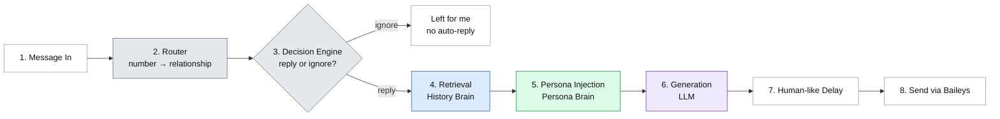

# Architecture — WhatsApp Cruise Control

> Hands-free WhatsApp replies, written in my own voice, by a local AI agent that uses retrieval (RAG) instead of fine-tuning.

This document explains how the whole system fits together before any code gets written. Every later session builds one box from this map, so when something breaks in Week 3 or Week 4, this is the page to come back to.

---

## 1. The problem, in plain words

I get a steady stream of WhatsApp messages: family checking in, friends sending memes, clients asking for an update. Most of them need a short, ordinary reply that I'd write the same way every time. Some of them really need *me*: money, serious news, anything from a stranger.

The goal is a small assistant that:

- reads an incoming message,
- works out who sent it and whether it's safe to answer automatically,
- looks at how I've actually replied to similar messages in the past,
- writes a reply that sounds like me *for that relationship* (I don't text my mother the way I text a client),
- waits a natural few seconds, and sends it.

Anything it isn't sure about, it leaves alone for me.

### The non-technical version

> It's like a personal assistant who has read years of my WhatsApp chats and carries a short note describing how I talk. When a message comes in, they check who it's from, decide whether it's something they should handle or pass to me, flip back through my old chats to see how I answered something similar, and then write a reply the way I would, after a short pause so it doesn't look robotic.

If I can explain the project like that to a friend, the architecture is clear in my head.

---

## 2. Design goals

| Goal | What it means in practice |
|---|---|
| **Sounds like me** | Tone, length, emoji habits and Hinglish match the relationship. |
| **Knows when to stay quiet** | Money, serious topics, strangers and group chats are never auto-answered. |
| **Explainable** | For any reply, I can see *why*: which past messages were pulled up and which persona tone was used. |
| **Free and local** | Runs on my laptop. Free-tier model only. No paid fine-tuning, no GPU. |
| **Easy to keep fresh** | New chats can be added any time without retraining anything. |
| **Safe by default** | Runs on a dedicated/secondary WhatsApp number, never my primary one. |

---

## 3. Why retrieval (RAG) and not fine-tuning

Fine-tuning would mean retraining a model's internal weights on all my chats so the model itself "becomes" me. It's the wrong tool here for four reasons:

1. **Cost and access.** Fine-tuning needs paid API access or my own GPU. RAG uses a model I never modify; I just give it the right context at the right moment.
2. **It goes stale.** A fine-tuned model is frozen at the version of me it was trained on. With RAG, memory is just a database: add new messages and the agent knows them immediately.
3. **It's a black box.** If a fine-tuned model says something odd, the reason is buried in millions of weights. With RAG I can say: "these three past messages were retrieved, and this persona tone was applied." That trace is what the live console will show in Week 4.
4. **It blends identity and memory together.** Fine-tuning mixes "how I generally talk" with "what I said to this one person" into a single blob. RAG keeps them as two separate, inspectable things. That separation is the whole "two-brain" idea.

---

## 4. The two brains

### Brain 1 — The Persona Brain (who I am)

- **What it is:** a hand-written persona file, authored once (Session 1.2).
- **What's in it:** my identity and interests, how my tone shifts between family / friends / professional / unknown contacts, my Hinglish habits, typical emoji use, typical message length, and a few example replies (few-shot examples).
- **How it's used:** on *every* generation, the section for the current relationship is placed at the top of the prompt as a character sheet. Nothing is trained; the model is simply reminded who it's playing.
- **What it does NOT contain:** specific past conversations.
- **Analogy:** the character brief you hand an actor before every take.

### Brain 2 — The History Brain (how I've actually replied)

- **What it is:** my real WhatsApp history, cleaned into pairs of *"they said X → I replied Y"*, stored in a vector database (ChromaDB) so it can be searched by meaning, not exact words.
- **How it's organised:** split into separate collections, one per relationship: `family`, `friends`, `professional`, `unknown`. When a client messages, only professional history is searched, so friend-group inside jokes can never leak into a work reply.
- **How it's used:** for a new message, the agent finds the 2–3 most similar past messages *in the matching collection* and adds my real replies to the prompt as examples.
- **Analogy:** the actor's own diary of what they said the last few times someone said something like this.

### Why both are needed

| Setup | Result |
|---|---|
| Persona only | Right tone, generic content. Sounds like a caricature of me. |
| History only | Specific, but no personality glue, and lost on any message type it hasn't seen before. |
| **Both** | The persona keeps brand-new situations in character; the history keeps familiar ones specific and real. |

---

## 5. The pipeline, stage by stage

One sentence to remember:

> **message in → who is it → should I even reply → what have I said before to people like this → who am I when I talk to them → write it → wait a beat → send it.**



**Colour key:** grey = plain rules, no AI · blue = History Brain · green = Persona Brain · purple = where both brains meet the AI · white = plumbing.

| # | Stage | Built in | Input | Output | Uses AI? |
|---|---|---|---|---|---|
| 1 | **Message In** | Week 4.1 | raw WhatsApp event | phone number + text | No |
| 2 | **Router** | Week 3.1 | phone number | relationship tag (e.g. `friend`) | No — lookup table |
| 3 | **Decision Engine** | Week 3.2 | tag + text | `reply` or `ignore` | Only as the last check |
| 4 | **Retrieval** | Week 2 | text + tag | top 2–3 similar past exchanges | Embeddings only |
| 5 | **Persona Injection** | Week 1.2 | tag | prompt with tone + retrieved examples | No |
| 6 | **Generation** | Week 4 | enriched prompt | draft reply | **Yes** (Gemini, free tier) |
| 7 | **Human-like Delay** | Week 4 | draft reply | random wait of a few seconds | No |
| 8 | **Send** | Week 4.1 | reply | delivered message | No |

### Stage notes

**1. Message In.** At this point the agent knows nothing except a phone number and some text.

**2. Router.** A simple table I maintain myself (e.g. `contacts.json` / `contacts.csv`) maps numbers to `family`, `friend`, `professional`. Anything not in the table is `unknown`. Deliberately not AI: it's fast, free, and never guesses wrong about who my mother is.

**3. Decision Engine.** Layered checks, cheapest first, so the AI is only consulted when the rules can't decide:

1. **Hard rules** — blocklist, group chats, unknown senders → ignore.
2. **Signal rules** — keywords/regex for money, payments, OTPs, urgent or serious topics → ignore.
3. **Intent check** — if still ambiguous, one small AI call classifies whether this is safe, casual chat.
4. **Reply policy** — per-relationship settings (e.g. auto-reply on for friends, off for professional during work hours).

The rule of thumb: **when in doubt, don't reply.** A missed auto-reply costs nothing; a wrong one can cost a relationship or a client.

**4. Retrieval.** Search *only* the matching relationship's ChromaDB collection for the 2–3 nearest past messages, and pull my actual replies to them.

**5. Persona Injection.** Combine the persona section for that relationship with the retrieved examples into a single prompt.

**6. Generation.** The model writes the reply using steps 4 and 5. It never sees the raw chat database, only the handful of examples chosen for this message.

**7. Human-like Delay.** A short random wait so replies don't arrive in 200 ms, which instantly gives a bot away.

**8. Send.** Baileys pushes the reply back through WhatsApp.

---

## 6. How a single message travels (worked example)

> A friend texts: *"bro free this weekend? movie plan"*

1. **Message In:** `+91 9xxxx xxxxx`, `"bro free this weekend? movie plan"`
2. **Router:** number found in contacts → `friend`
3. **Decision Engine:** not a group, not blocked, no money/serious keywords, casual plan → `reply`
4. **Retrieval:** searches `friends` collection → finds three past "weekend plan?" messages and how I answered them
5. **Persona Injection:** friend-tone section (casual, Hinglish, short, a couple of emojis) + those three examples
6. **Generation:** something like *"haan free hu saturday evening 🍿 which one?"*
7. **Delay:** waits ~6 seconds
8. **Send:** reply delivered

> A client texts: *"Can you share the invoice for last month's grade?"*

Router → `professional`. Decision Engine sees *invoice* → money signal → `ignore`. Nothing is sent; it waits for me.

---

## 7. Tech stack

| Layer | Tool | Why | Needed from |
|---|---|---|---|
| Editor + pair-programmer | VS Code, GitHub Copilot + Copilot Chat | Every session's build prompts run here | Now |
| Version control | Git + GitHub | Track every session's changes | Now |
| Data processing, retrieval, generation | Python 3.10+ | Parsing chats, ChromaDB, LLM calls | Now |
| WhatsApp connection | Node.js 18+ with Baileys | Sends/receives WhatsApp messages | Week 4 |
| Memory (History Brain) | ChromaDB (local) | Free vector store, one collection per relationship | Week 2 |
| Language model | Gemini Flash via free API key (Google AI Studio) | Free tier, fast enough for chat | Week 1.2 onward |
| Live console | Streamlit | Shows each message's route, retrieved context and decision | Week 4 |
| Diagrams | Excalidraw, Mermaid | Architecture sketch + text version in this file | Now |

Secrets (the Gemini API key) live in a `.env` file that is **never committed**.

---

## 8. Planned project layout

This will grow session by session; it's the target shape, not what exists today.

```
whatsapp-cruise-control/
├── README.md
├── Architecture.md              ← this file
├── .env                         ← GEMINI_API_KEY (git-ignored)
├── .gitignore
├── docs/
│   ├── architecture_diagram.png
│   └── architecture_diagram.excalidraw
├── persona/
│   └── persona.md               ← Persona Brain (Session 1.2)
├── data/
│   ├── raw/                     ← WhatsApp exports (git-ignored)
│   └── processed/               ← cleaned "they said → I replied" pairs
├── history/                     ← ChromaDB store (git-ignored)
├── config/
│   ├── contacts.json            ← Router lookup table
│   └── rules.yaml               ← Decision Engine keywords & policies
├── src/
│   ├── ingest/                  ← Week 2: parse + split by relationship
│   ├── router/                  ← Week 3.1
│   ├── decision/                ← Week 3.2
│   ├── retrieval/               ← Week 2
│   ├── generate/                ← persona injection + LLM call
│   └── console/                 ← Streamlit dashboard
└── bot/                         ← Node.js + Baileys (Week 4)
```

Python handles the "thinking" (route, decide, retrieve, generate); Node handles the WhatsApp socket. The two talk over a small local interface, set up in Week 4.

---

## 9. Build roadmap

| Week | Theme | Sessions | Box from the pipeline |
|---|---|---|---|
| 1 | **The Ghostwriter** — teach it my voice | 1.1 Two-Brain Architecture · 1.2 Build the Persona File | Persona Injection |
| 2 | **The Curator** — give it memory | 2.1 Mine my history · 2.2 Sort by relationship | Retrieval |
| 3 | **The Router** — teach it judgement | 3.1 Who's texting? · 3.2 Reply or ignore? | Router, Decision Engine |
| 4 | **The Puppetmaster** — connect it to WhatsApp | 4.1 Wire up Baileys · 4.2 Go live | Message In, Delay, Send |

---

## 10. Safety, privacy and guardrails

- **Dedicated number only.** Baileys is an unofficial WhatsApp Web client. Using it can break WhatsApp's terms and risk a ban, so this runs on a spare SIM or secondary account, never my primary number.
- **Other people's words.** My exports contain messages from friends, family and clients. Raw exports and the ChromaDB store stay local and are git-ignored.
- **Default to silence.** Unknown senders, groups, money and serious topics are never auto-answered.
- **Relationship isolation.** Separate collections mean the wrong tone or a private joke can't leak across contexts.
- **Kill switch.** One config flag (or stopping the Node process) turns auto-replies off instantly.
- **Visible reasoning.** The console logs, for every message: relationship tag, decision and reason, retrieved examples, and the final reply.

---

## 11. Glossary

| Term | Plain meaning |
|---|---|
| **LLM** | The AI model that writes text (here, Gemini). |
| **RAG** | Retrieval-Augmented Generation: look up relevant notes first, then write. |
| **Embedding** | Turning a sentence into numbers so "similar meaning" can be measured. |
| **Vector database** | A store that searches by meaning (ChromaDB). |
| **Few-shot prompt** | Giving the model a few examples of the style you want, right inside the prompt. |
| **Fine-tuning** | Retraining the model itself on new data. Not used here. |
| **Baileys** | A Node.js library that connects to WhatsApp Web. |

---

## 12. Understanding checkpoint

1. **Why not fine-tune?** It costs money or a GPU, freezes me in time, can't explain itself, and blends identity with memory. RAG avoids all four.
2. **Persona vs history?** Persona = how I talk to each kind of person. History = what I've actually said before.
3. **Why split history by relationship?** So a client never gets a reply shaped by my friends' banter, and searches stay relevant.
4. **Which stages are the brains, and which are plumbing?** Retrieval is the History Brain, Persona Injection is the Persona Brain, Generation is where they combine. Router and Decision Engine are rules; Message In, Delay and Send are plumbing.