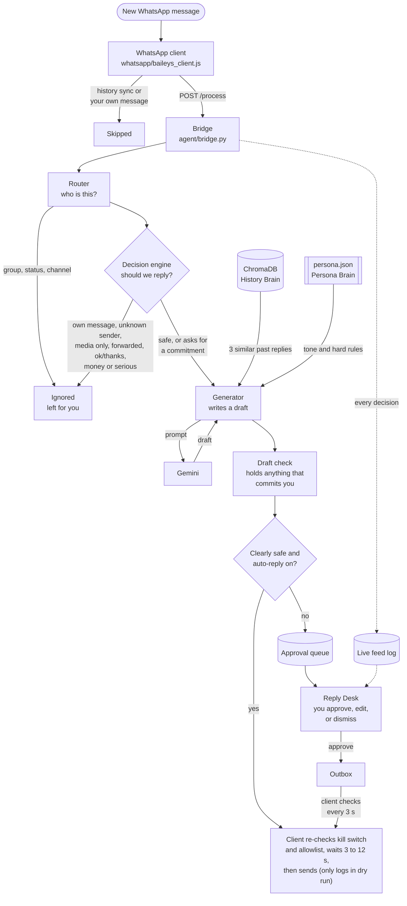
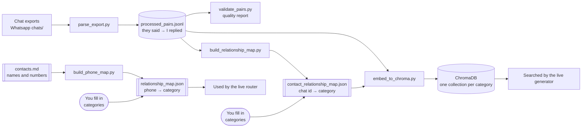

# Architecture

This page explains how the WhatsApp Agent works: what each part does, what it needs, what it produces, and how a single message travels from your phone to a reply. It stays at the level of "what and why", not line-by-line code. For installation and commands, see the [README](README.md).

---

## 1. The big picture

You get a steady stream of WhatsApp messages. Many need a short, ordinary reply you'd write the same way every time: "Reached?", "Got it, I'll check and get back to you". Some really need *you*: money, plans, anything serious, anyone you don't know.

The agent handles the first kind and steps aside for the second. For every incoming message it:

1. works out **who** sent it (family, friend, partner, colleague, client, or a stranger);
2. decides whether it's **safe** to answer at all;
3. looks up how you've **actually replied** to similar messages before;
4. writes a draft **in your voice for that relationship**;
5. **checks the draft** for anything that commits you to something;
6. either sends it after a natural pause, or puts it in front of you to approve.

If you could hand a trusted assistant years of your chats and a short note on how you talk to each kind of person, this is what they'd do: read the message, decide whether it's theirs to answer, glance back at how you handled something similar, and reply the way you would, or leave it on your desk.

### The two brains

The agent draws on two separate kinds of knowledge, and keeps them apart on purpose.

| | Persona Brain | History Brain |
|---|---|---|
| **What it is** | A hand-written description of how you talk (`persona/persona.json`) | Your real chat history, as "they said → I replied" pairs, stored in ChromaDB |
| **What it knows** | Your identity, your tone for each relationship, typical message length, favourite emoji, and hard rules the agent must never break | What you actually said, word for word, to messages like this one |
| **How it's used** | The section for the sender's relationship goes into every prompt | The 3 most similar past exchanges, from the same relationship only, go into the prompt as examples |
| **Analogy** | The character brief an actor reads before every scene | The actor's diary of what they said the last few times |

With only the persona, replies have the right tone but generic content. With only the history, replies are specific but fall apart on anything new. Together, the persona keeps new situations in character and the history keeps familiar ones real.

This approach is called **retrieval** (or RAG: "look things up, then write"), as opposed to **fine-tuning** (retraining the AI model itself on your chats). Retrieval is free, updates the moment you add new chats, and can always show *why* it wrote a reply, because you can see exactly which past messages it used.

### Relationship categories

Everyone is sorted into one category, and each category has its own persona section and its own slice of history:

| Category | Who | Typical voice |
|---|---|---|
| `family` | Amma, Appa, relatives | Short, practical, Tanglish with Amma, English with Appa |
| `friends` | College friends | Relaxed Tanglish, "da" |
| `girlfriend` | Partner | Warm, playful Tanglish |
| `professional` | Colleagues, teachers, services | Polite, plain English |
| `business_freelance` | Directors, DPs, studios, clients | Collaborative, technical, "check once" |
| `unknown` | Anyone not in your contacts | Never answered automatically |

Keeping history separate per category means a client can never get a reply shaped by your friends' banter.

---

## 2. The main components

| Component | Language | Runs as | Role |
|---|---|---|---|
| **WhatsApp client** | Node.js | `node whatsapp/baileys_client.js` | Connects to WhatsApp, hands each new message to the bridge, sends replies |
| **Bridge** | Python (FastAPI) | `python3 agent/bridge.py` on port 5001 | The agent's front door: runs the whole decision pipeline for each message |
| **Agent core** | Python | used by the bridge | Router, decision engine, generator, draft check, approval queue |
| **History Brain** | Python + ChromaDB | `chroma run …` on port 8000 | Stores and searches your past replies |
| **Persona Brain** | JSON | read on every draft | How you talk to each kind of person |
| **Reply Desk** | Python (FastAPI) + HTML/JS | `python3 console/app.py` on port 5002 | Your dashboard: live feed, approvals, auto-reply switch |
| **Setup scripts** | Python | run by hand, occasionally | Turn chat exports and contacts into the maps and the history database |

Python does the thinking; Node does the WhatsApp talking. They speak to each other over plain HTTP on your own machine (`127.0.0.1`), so nothing is exposed to the network.

---

## 3. How a live message flows

**Reading the diagram:** solid arrows are the path of one message, and dotted arrows are logging for Reply Desk. The decision engine also uses Gemini, but only once, as its last check (see [section 5](#5-how-the-pieces-connect)).

---

## 4. One-time setup flow

Before the agent can answer anything, your chat exports and contacts are turned into two maps and a searchable history. You run these scripts by hand once, and again whenever you add new exports.

There are two maps because they answer two different questions:

- **`relationship_map.json`** answers "*who is texting me right now?*" It's keyed by phone number, because that's how a live WhatsApp message identifies its sender.
- **`contact_relationship_map.json`** answers "*which category does this old chat belong to?*" It's keyed by an anonymous chat id (like `chat-e9b783a5b9`), so contact names never end up in the history database.

Both maps are filled in by you; the scripts never guess a relationship.

---

## 5. How the pieces connect

Here is one message's journey, in order.

**1. A message arrives.** The WhatsApp client receives it through Baileys. It ignores anything that isn't a genuinely new message (WhatsApp replays old messages when you first connect) and anything you sent yourself. For the rest, it pulls out the sender's ID, the text or caption, the message type, and whether it was forwarded, then sends them to the bridge.

**2. The router identifies the sender.** WhatsApp identifies chats by an ID called a **JID**, for example `919025877874@s.whatsapp.net` for a person or `…@g.us` for a group. The router turns a person's JID into a phone number and looks it up in `relationship_map.json`. Group chats, status updates and channels are stopped right here, before the map is even read. Numbers not in the map become `unknown`.

**3. The decision engine decides whether to reply.** It works through layers, cheapest first, and stops at the first "no":

- **Hard rules**, which are instant: your own message, groups, unknown senders.
- **Signal rules**, still instant: photos or voice notes with no caption, forwarded messages, one-word replies like "ok" or "thanks".
- **Intent check**, a single Gemini call that labels the message as safe, as *money or serious*, or as *asking you to commit* to a plan, invite, call or time. Money and serious topics are left for you. A commitment request still gets a draft, but that draft must be approved. If Gemini's answer is anything unexpected, the engine **fails closed**: it treats the message as serious and leaves it alone.

**4. The generator writes a draft.** It asks the History Brain for your three most similar past exchanges in the same category, adds the persona section for that relationship and your hard rules, and asks Gemini for one short reply. The prompt tells it never to commit you to plans, and never to invent where you are or what you're doing; it leaves a `[placeholder]` instead.

**5. The draft check reviews it.** This last check uses no AI, just fixed word lists, so the same draft always gets the same verdict. It holds any draft that says yes or agrees ("aama", "sure", "ok da", "varen", "pesalam"…), names a time or day, contains a placeholder, or is empty. Drafts for unknown senders are always held, and are never allowed to confirm your name.

**6. The bridge makes the final call.** A draft is sent automatically only if it passed every check **and** the auto-reply switch is on. Otherwise it's stored in the approval queue. Either way, the decision is written to the live feed log.

**7. You decide, in Reply Desk.** Held drafts appear with the sender's name, their message, the reason the draft was held, and an editable reply. **Approve** puts your reply in the outbox; **Dismiss** drops it.

**8. The client sends.** The client reads `config/settings.json` fresh for every message. For an automatic reply it waits a random delay (3 to 12 seconds by default) so it doesn't look robotic. For approved replies, it checks the outbox every 3 seconds. Right before any send, it re-checks the kill switch and checks the sender against `relationship_map.json` itself, independently of the bridge; a sender who isn't mapped to a real category is blocked. If `dry_run` is on, it only logs what it would have sent. While `kill_switch.flag` exists, the client does nothing at all.

---

## 6. Module breakdown

### WhatsApp side

| Module | Purpose | Inputs | Output |
|---|---|---|---|
| `whatsapp/baileys_client.js` | Connects to WhatsApp as a linked device, forwards new messages to the bridge, sends replies. | WhatsApp events; bridge responses; the outbox; `config/settings.json`; `kill_switch.flag`; `config/relationship_map.json` (its own allowlist check) | Calls to the bridge; sent messages, or `[DRY_RUN]` log lines; saved login in `auth_info_baileys/` |

### Agent core (`agent/`)

| Module | Purpose | Inputs | Output |
|---|---|---|---|
| `bridge.py` | The local web server the client talks to. Runs the pipeline, applies the auto-reply switch, records held drafts, serves the outbox. | A message (`jid`, `text`, `message_type`, `is_forwarded`, `from_me`, optional `chat_jid`) | A decision (`should_reply`, `reply`, `relationship`, `reason`, `status`, …); a line in `logs/console_feed.jsonl` |
| `router.py` | Works out the sender's category from their JID. | A JID; `config/relationship_map.json` | A category and the history collection to search, or "group" with no collection |
| `decision_engine.py` | Decides whether a message deserves a reply. | The message and its category | Yes or no, with a reason; a line in `logs/decision_log.jsonl` |
| `generator.py` | Writes a draft in your voice. | The message text and category; `persona.json`; similar past replies | The draft text, or a safe placeholder if the AI returned nothing |
| `draft_guard.py` | Holds drafts that commit you to something, using fixed word lists (no AI). | A draft and its category | OK, or "needs approval" with the reason |
| `pipeline.py` | Runs decision → draft → draft check in order. | A message and its category | `ready`, `needs_approval` or `ignored`, plus the draft and reasons |
| `approvals.py` | The approval queue, shared safely by the bridge and Reply Desk. | Held drafts; your approve and dismiss decisions; the client's "sent" reports | Records in `data/agent_state.sqlite3` moving through pending → approved → sent, dry run, or dismissed |
| `settings.py` | Reads and writes the auto-reply switch. | `config/auto_reply.json` | On or off. Anything other than an explicit `true` counts as off. |
| `gemini.py` | Creates the shared Gemini connection. | `GEMINI_API_KEY` from `.env` | A ready-to-use client for model `gemini-3.5-flash` |
| `batch_test.py` | A demo run of 11 sample messages through every layer. | Your phone map; Gemini | A summary table in the terminal |

### History Brain (`ingestion/`)

| Module | Purpose | Inputs | Output |
|---|---|---|---|
| `parse_export.py` | Turns chat exports into clean "they said → I replied" pairs: skips media, system lines and one-word acks, splits conversations at long gaps, and masks emails, numbers and passwords. | `Whatsapp chats/**/*.txt`; your name (`--name`) | `data/processed_pairs.jsonl` |
| `validate_pairs.py` | Quality report on the pairs. | The pairs file; the exports | Pass or fail checks and a random sample, printed |
| `build_relationship_map.py` | Adds any new chat ids to the chat-category map, without touching ones you've filled in. | The pairs file | `config/contact_relationship_map.json`, with new ids set to `REPLACE_ME` |
| `validate_relationship_map.py` | Confirms every chat with history has a category. | Pairs file; chat map | PASS, or FAIL with what's missing |
| `build_phone_map.py` | Adds new phone numbers from your contacts to the phone-category map, keeping everything you've set. | `config/contacts.md`; your name | `config/relationship_map.json`, with new numbers set to `REPLACE_ME`; a backup in `config/backups/` |
| `validate_phone_map.py` | Confirms the phone map is safe for live routing. | Phone map; contacts | PASS, or FAIL with each problem |
| `embed_to_chroma.py` | Turns each "they said" message into a meaning-vector and stores it, so it can be searched by meaning. | Pairs file; chat map | ChromaDB collections, one per category, matching the pairs file exactly |
| `retrieval.py` | Finds your most similar past exchanges for a new message. | A category, a message, how many results | A list of past exchanges with similarity scores |
| `retrieval_demo.py` | Tries out retrieval from the terminal. | Optional category, contact, JID or query | Readable result blocks and a sanity check |
| `whatsapp_ids.py` | Understands WhatsApp IDs and phone formats. | JIDs, phone numbers | Normalised numbers; what kind of chat a JID is |

### Persona Brain (`persona/`)

| Module | Purpose | Inputs | Output |
|---|---|---|---|
| `persona.json` | How you talk to each kind of person, plus hard rules. | Written by hand | Read by the generator for every draft. Its relationship sections also define the list of categories. |
| `build_persona.py` | Measures your style from an export: how much Tanglish, message length, top emoji. | One iPhone-format export; your name | A style-signals JSON file (generated, git-ignored), to help you write `persona.json` |

### Reply Desk (`console/`, `frontend/`)

| Module | Purpose | Inputs | Output |
|---|---|---|---|
| `console/app.py` | Serves Reply Desk and its API: live feed with contact names, approval queue, the auto-reply switch, live/dry-run sending, reply delays, and the kill switch. It accepts changes only from its own page. | Feed log; approval queue; `contacts.md`; `config/settings.json`; `kill_switch.flag` | Web pages at port 5002 (`/` and `/basic`); switch and settings changes (written atomically); approvals into the outbox |
| `frontend/` (`index.html`, `styles.css`, `app.js`) | The dashboard in your browser. Refreshes every 2 seconds, with light and dark themes. | The console API | What you see and click |

### Configuration (`config/`)

| File | Holds |
|---|---|
| `contacts.md` | Your address book: names and phone numbers |
| `relationship_map.json` | Phone number → category (the live router's table) |
| `contact_relationship_map.json` | Anonymous chat id → category (for filing history) |
| `auto_reply.json` | The auto-reply switch |
| `settings.json` | The client's `dry_run` flag and pre-send delay range |
| `settings.py` | Python helpers for the settings (including safe, atomic saving), the kill switch, and the allowlist |
| `constants.py` | The one-word acknowledgements list |

---

## 7. Safety, layer by layer

No single check is trusted on its own. Each risk is caught in at least two places.

| Risk | Where it's caught |
|---|---|
| Replying in a group | Router (group IDs never routed), decision engine (hard rule), client (refuses to send to groups) |
| Replying to a stranger | Router (`unknown`), decision engine (hard rule), draft check (always holds, never confirms your name) |
| Agreeing to plans, calls or times | Decision engine (intent check), prompt (never a firm yes), draft check (word lists) |
| Money or serious topics | Decision engine (intent check; anything unclear counts as serious) |
| Sending anything at all | Auto-reply switch (off by default), dry run in `settings.json` (on by default), and the kill switch (`kill_switch.flag`), which stops everything |
| Sending to someone not in your contacts | The client's own allowlist check against `relationship_map.json`, right before every send, regardless of what the bridge decided |
| A broken config file | Map loading fails loudly instead of guessing; maps are written atomically, so a crash can't leave a half-written file |
| Another website controlling Reply Desk | Reply Desk accepts changes only from its own page, on this machine |
| Leaking private data | Exports, pairs, the database, logs, contacts and the phone map are all git-ignored; pairs have emails, numbers and passwords masked |

---

## 8. Where data lives

| Location | Contents | In git? |
|---|---|---|
| `Whatsapp chats/` | Your chat exports | Yes (private repository) |
| `data/processed_pairs.jsonl` | Cleaned pairs | No |
| `data/agent_state.sqlite3` | The approval queue | No |
| `chroma_data/` | The ChromaDB history database | No |
| `logs/console_feed.jsonl` | Every bridge decision, for Reply Desk | No |
| `logs/decision_log.jsonl` | Every decision-engine verdict | No |
| `auth_info_baileys/` | Your WhatsApp login | No, never |
| `.env` | Your Gemini API key | No, never |

---

## 9. Glossary

| Term | Plain meaning |
|---|---|
| **LLM** | The AI model that writes text. Here, Google's Gemini. |
| **RAG / retrieval** | "Look things up, then write": the agent finds relevant past replies before drafting. |
| **Fine-tuning** | Retraining the AI model itself on your data. Not used here. |
| **Embedding** | Turning a sentence into a list of numbers so "similar meaning" can be measured. |
| **Vector database** | A database that searches by meaning instead of exact words. Here, ChromaDB. |
| **Collection** | One searchable bucket in ChromaDB. There's one per relationship category. |
| **Few-shot examples** | A few sample replies placed in the prompt to show the AI the style you want. |
| **JID** | WhatsApp's ID for a chat, such as `919025877874@s.whatsapp.net` for a person or `…@g.us` for a group. |
| **Baileys** | A Node.js library that connects to WhatsApp Web as a linked device. |
| **Bridge** | The small local web server that connects the Node client to the Python agent. |
| **Fail closed** | When unsure, choose the safe option, which here means don't reply. |
| **DRY_RUN** | A mode where the client logs what it would send without sending anything. |
| **Tanglish** | Tamil written in English letters, mixed with English. |
